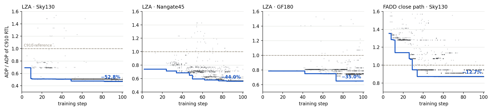

# Alpha-RTL

**Test-time training for RTL hardware optimization.**

Peilong Zhou, Zhirong Chen, Cangyuan Li, Haoyu Gao, Kaiyan Chang, Ziming Qu, Ying Wang
SKLP, Institute of Computing Technology, CAS · University of Chinese Academy of Sciences

[](https://arxiv.org/abs/2606.05253)
[](https://dragonzhoulong.github.io/Alpha-RTL/)
[](LICENSE)

Alpha-RTL brings [TTT-Discover](https://github.com/test-time-training/discover) to hardware design. For a single
RTL module it samples rewrites from an LLM, checks each one with simulation, logic synthesis and static timing,
and updates the model's weights on that feedback, so later rewrites build on what the EDA tools taught it.
Pointed at hand-written floating-point units from the open-source
[XuanTie C910](https://github.com/XUANTIE-RV/openc910) RISC-V core, it finds designs with up to **52.8% lower
area × delay** than the shipped RTL, and every reported design is **formally proven equivalent** to the original.



*Each dot is a functionally correct rollout (32 sampled per step); the blue line is the best design found so far.
ADP is normalized to the C910 reference (dashed).*

## Key results

All rows: Qwen3-8B, 100 training steps on 8 GPUs. Area from Yosys technology mapping, delay from OpenSTA.

| Module | Library | C910 area (µm²) | C910 delay (ps) | Alpha-RTL area (µm²) | Alpha-RTL delay (ps) | ΔADP |
|---|---|---:|---:|---:|---:|---:|
| `ct_vfmau_lza_simd_half` (24-bit LZA) | Sky130 HD | 1552.7 | 2191.1 | 1228.7 | 1306.4 | **−52.8%** |
| `ct_vfmau_lza_simd_half` | Nangate45 | 315.2 | 496.3 | 234.1 | 374.1 | **−44.0%** |
| `ct_vfmau_lza_simd_half` | GF180MCU | 4930.4 | 14659.0 | 3835.0 | 12241.1 | **−35.0%** |
| `ct_fadd_close_s0_d` (FP64 adder close path) | Sky130 HD | 6487.5 | 3486.2 | 5696.7 | 3466.0 | **−12.7%** |

The Sky130 LZA row is the best of four seeds; the four seeds reach −52.8%, −52.5%, −52.1% and −43.3% (mean −50.2%).
Designs, per-step rollout data and design lineages are in [`results/c910/`](results/c910).

**What it found.** C910 decodes the LZA's 24-bit pre-encoded vector with one flat 24-way `casez`. Alpha-RTL splits it
into six 4-bit groups, reuses C910's own `ct_vfmau_lza_42` cell for each group's valid bit and position, and selects
the first valid group: 20.9% less area and 40.4% less delay. On the FP64 close path it replaces a 51-way `casez`
find-first-one with a two-level encoder over 16-bit groups and derives the one-hot output by a shift.
The [project page](https://dragonzhoulong.github.io/Alpha-RTL/) shows every ancestor of each final design next to
the C910 original.

## How it works

1. **Select.** PUCT picks parent designs from an archive of verified candidates.
2. **Rewrite.** The policy reads the parent RTL plus its tool feedback and proposes a new module.
3. **Verify.** Icarus Verilog compiles it and compares it with the C910 RTL on random and edge-case vectors.
4. **Measure.** Yosys maps it to standard cells; OpenSTA reports the critical path.
5. **Learn.** An entropic policy-gradient update (TTT-Discover's objective, with a KL budget) trains on the
   step's rewards. Verified rewrites go back into the archive.

```
reward = 0.1·[compiles] + 1.0·[matches reference] + 10 · ADP_ref / ADP
```

## Installation

**EDA tools** (must be on `PATH`): [Icarus Verilog](https://github.com/steveicarus/iverilog) ≥ 11,
[Yosys](https://github.com/YosysHQ/yosys) (we used 0.62) and [OpenSTA](https://github.com/The-OpenROAD-Project/OpenSTA).
Yosys and Icarus are on conda-forge: `conda install -c conda-forge yosys iverilog`.

**Training stack.** Alpha-RTL runs as a set of [verl](https://github.com/volcengine/verl) recipes on verl v0.5.0
plus a 50-line patch (custom advantage estimators and KL-in-advantage support):

```bash
git clone https://github.com/Dragonzhoulong/Alpha-RTL.git && cd Alpha-RTL
bash scripts/setup_verl.sh            # clones verl v0.5.0 into ./verl, applies patches/, links recipe/
cd verl && pip install -e . && pip install vllm   # follow verl's install guide for your CUDA version
```

## Reproducing the C910 results

Run from `verl/`. The Slurm script starts a single-node Ray cluster (8 GPUs) and trains for 100 steps.
`MODEL_PATH` takes a local path or `Qwen/Qwen3-8B`; set `OPENSTA_BINARY` if `sta` is not on `PATH`.

```bash
cd verl
export MODEL_PATH=Qwen/Qwen3-8B

# LZA, Sky130 (seed 4)
EXP_NAME=lza_sky130 sbatch recipe/ttt_c910_fpu/run_ttt_c910_lza_simd_half.slurm \
    data.ttt_c910.seed=4 +actor_rollout_ref.rollout.seed=4

# LZA, Nangate45 / GF180
EXP_NAME=lza_nangate45 LIBERTY_FILE=recipe/ttt_rtl/pdk/Nangate45_typ.lib \
    sbatch recipe/ttt_c910_fpu/run_ttt_c910_lza_simd_half.slurm
EXP_NAME=lza_gf180 LIBERTY_FILE=recipe/ttt_rtl/pdk/gf180mcu_fd_sc_mcu7t5v0__tt_025C_1v80.lib \
    sbatch recipe/ttt_c910_fpu/run_ttt_c910_lza_simd_half.slurm

# FP64 adder close path, Sky130 (adaptive KL budget)
EXP_NAME=fadd_sky130 C910_PROBLEMS=fadd_close_s0_d KL_BUDGET_MODE=adaptive \
    sbatch recipe/ttt_c910_fpu/run_ttt_c910_lza_simd_half.slurm
```

Without Slurm, start Ray yourself and run `bash recipe/ttt_c910_fpu/run_ttt_c910.sh` with the same variables
(`CONFIG_NAME=ttt_c910_lza_simd_half`).

### Verifying a design

Training-time simulation samples a few hundred vectors. Before reporting a design, check it against the reference
with a formal equivalence proof and a fresh synthesis run:

```bash
python ../scripts/verify_design.py --problem lza_simd_half \
    --design ../results/c910/lza_sky130/discovered.v \
    --liberty recipe/ttt_rtl/pdk/sky130_fd_sc_hd__tt_025C_1v80.lib
```

To pick the best formally verified design of a finished run and export its trajectory and lineage:

```bash
python ../scripts/export_run.py --run-dir checkpoints/verl-ttt-c910/lza_sky130 \
    --problem lza_simd_half --liberty recipe/ttt_rtl/pdk/sky130_fd_sc_hd__tt_025C_1v80.lib \
    --out ../results/c910/my_lza_run
```

## Optimizing your own module

Add a directory under `recipe/ttt_c910_fpu/problems/<problem_id>/`:

| File | Purpose |
|---|---|
| `spec.yaml` | `problem_id`, `design_name`, description, ports, and `deps` |
| `reference.v` | the original RTL; shown to the model and used as the ADP baseline |
| `reference_renamed.v` | the same RTL with the top module renamed to `<design_name>_ref`, used as the golden model |
| `testbench.v` | instantiates both modules, drives random and edge-case inputs, prints `Your Design Passed` when all outputs match |
| `prompt_template.txt` | task description and constraints for the model |
| `deps/*.v` | submodules the reference (and candidates) may instantiate |

Then launch with `C910_PROBLEMS=<problem_id>`. If the spec has don't-care outputs, add a custom miter for it in
`scripts/verify_design.py`.

## RTLLM pipeline

`recipe/ttt_rtl/` runs the same algorithm over [RTLLM v2.0](https://github.com/hkust-zhiyao/RTLLM) designs, with
an optional SFT warm-up stage (`recipe/ttt_rtl/sft/`). See [`recipe/ttt_rtl/README.md`](recipe/ttt_rtl/README.md).
`recipe/ttt_math_construct/` is our verl port of TTT-Discover on the Erdős minimum-overlap problem, which the RTL
recipes reuse for the entropic advantage and state-pool logic.

## Repository layout

```
recipe/
  ttt_c910_fpu/        C910 pipeline: dataset/prompting, PUCT sampler, EDA reward, problems/, launch scripts
  ttt_rtl/             RTLLM pipeline, shared EDA utilities (Icarus, Yosys, OpenSTA), pdk/ liberty files
  ttt_math_construct/  TTT-Discover algorithm port (entropic advantage, state pool)
patches/               verl v0.5.0 patch
scripts/               setup, verification, export, plotting and project-page build
results/c910/          verified designs, per-step rollouts and lineages for every reported run
site/                  project page template
```

## Acknowledgments

Alpha-RTL builds on [TTT-Discover](https://github.com/test-time-training/discover) and
[verl](https://github.com/volcengine/verl). Reference RTL comes from
[openc910](https://github.com/XUANTIE-RV/openc910) (Apache-2.0, T-Head Semiconductor); see
[`recipe/ttt_c910_fpu/problems/NOTICE`](recipe/ttt_c910_fpu/problems/NOTICE). Liberty files are listed in
[`recipe/ttt_rtl/pdk/README.md`](recipe/ttt_rtl/pdk/README.md).

## Citation

```bibtex
@article{zhou2026alphartl,
  title   = {Alpha-RTL: Test-Time Training for RTL Hardware Optimization},
  author  = {Zhou, Peilong and Chen, Zhirong and Li, Cangyuan and Gao, Haoyu and
             Chang, Kaiyan and Qu, Ziming and Wang, Ying},
  journal = {arXiv preprint arXiv:2606.05253},
  year    = {2026}
}
```

## License

Apache-2.0. See [LICENSE](LICENSE).
